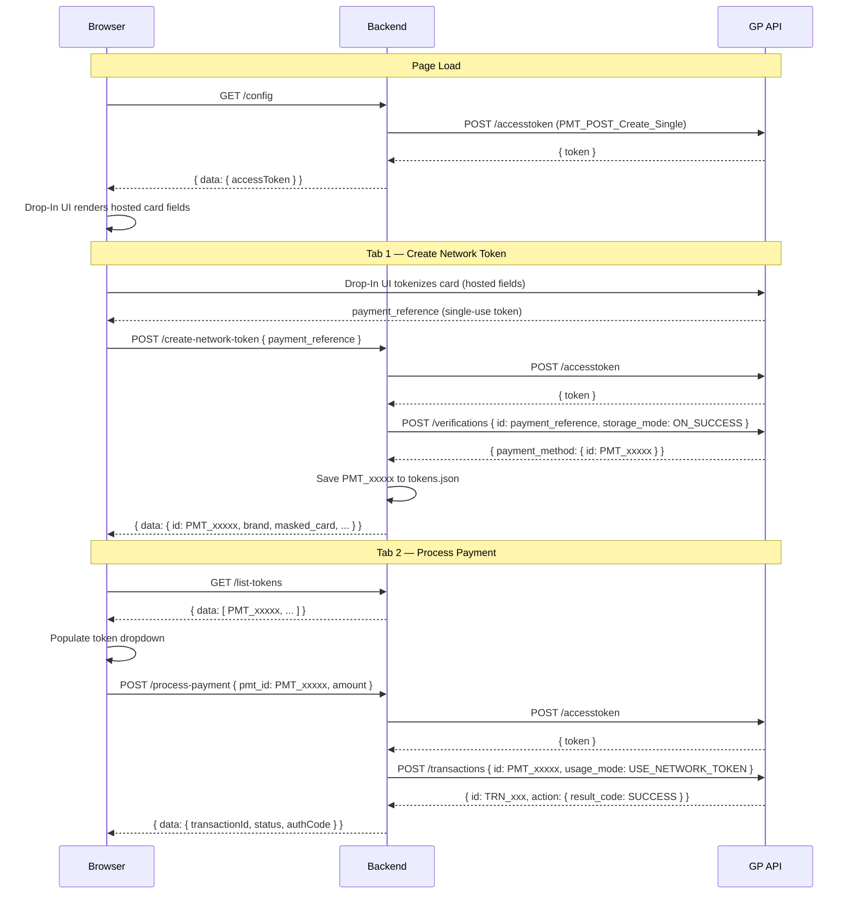

# Network Tokenization — Global Payments

A multi-language sample project demonstrating network tokenization with the [GP API](https://developer.globalpayments.com). Network tokenization replaces raw card numbers with network-issued tokens managed by Visa and Mastercard, enabling more secure storage and higher authorization rates for card-not-present transactions.

This project shows the complete lifecycle: collecting a card via the Drop-In UI, converting the single-use token into a reusable network token (PMT ID), and processing payments against that token with `USE_NETWORK_TOKEN` mode. PHP and Node.js use the official Global Payments SDK; .NET, Java, Python, and Go use direct GP API HTTP calls.

## Features

- **Drop-In UI card collection** — PCI-compliant hosted fields; no raw card data touches your server
- **Network token creation** — converts a single-use Drop-In UI token into a multi-use `PMT_xxxxx` network token via `/verifications` with `storage_mode: ON_SUCCESS`
- **Token storage** — saves PMT IDs to `data/tokens.json` for reuse across sessions
- **Payment processing** — charges a saved network token with `usage_mode: USE_NETWORK_TOKEN`
- **Sandbox and production** — toggled with a single environment variable
- **Six language implementations** — PHP, Node.js, .NET, Java, Python, Go

## Available Implementations

| Language | Framework | Dependency | CodeSandbox |
|----------|-----------|------------|-------------|
| [**PHP**](./php/) | Built-in Server | globalpayments/php-sdk ^13.4 | [Open in CodeSandbox](https://githubbox.com/globalpayments-samples/network-tokenization/tree/main/php) |
| [**Node.js**](./nodejs/) | Express | globalpayments-api ^3.10.6 | [Open in CodeSandbox](https://githubbox.com/globalpayments-samples/network-tokenization/tree/main/nodejs) |
| [**.NET**](./dotnet/) | ASP.NET Core | Direct HTTP (DotEnv.Net only) | [Open in CodeSandbox](https://githubbox.com/globalpayments-samples/network-tokenization/tree/main/dotnet) |
| [**Java**](./java/) | Tomcat / Jakarta Servlet | Direct HTTP (dotenv-java, json) | [Open in CodeSandbox](https://githubbox.com/globalpayments-samples/network-tokenization/tree/main/java) |
| [**Python**](./python/) | Flask | Direct HTTP (Flask, python-dotenv) | [Open in CodeSandbox](https://githubbox.com/globalpayments-samples/network-tokenization/tree/main/python) |
| [**Go**](./go/) | net/http | Direct HTTP (godotenv) | [Open in CodeSandbox](https://githubbox.com/globalpayments-samples/network-tokenization/tree/main/go) |

## Quick Start

```bash
git clone https://github.com/globalpayments-samples/network-tokenization.git
cd network-tokenization/{language}
cp .env.sample .env
# Edit .env — fill in GP_API_APP_ID and GP_API_APP_KEY
./run.sh
```

Open `http://localhost:8000` in your browser.

**Manual start per language:**

```bash
# PHP
cd php && ./run.sh

# Node.js
cd nodejs && npm install && node server.js

# .NET
cd dotnet && dotnet run

# Java
cd java && mvn package -q && mvn cargo:run -q

# Python
cd python && pip install -r requirements.txt && python server.py

# Go
cd go && go run main.go
```

## Flow



## API Endpoints

### `GET /config`

Returns a scoped Drop-In UI access token. The token carries only the `PMT_POST_Create_Single` permission so it can tokenize a card but cannot process payments.

**Response**
```json
{
  "success": true,
  "data": {
    "accessToken": "S0BiXG7jfVkBPKlMPIR..."
  }
}
```

**Error**
```json
{
  "success": false,
  "message": "Configuration error: Status Code: ACTION_NOT_AUTHORIZED"
}
```

---

### `POST /create-network-token`

Converts a single-use Drop-In UI token into a reusable network token. Calls GP API `/verifications` with `storage_mode: ON_SUCCESS` and persists the returned PMT ID to `data/tokens.json`.

**Request**
```json
{
  "payment_reference": "PMT_single_use_token_from_drop_in"
}
```

**Response**
```json
{
  "success": true,
  "data": {
    "id": "PMT_a1b2c3d4e5f6g7h8",
    "brand": "VISA",
    "masked_card": "2970",
    "usage_mode": "USE_NETWORK_TOKEN",
    "status": "Active",
    "created_at": "2025-05-11T14:30:00Z"
  },
  "message": "Network token created successfully"
}
```

**Error**
```json
{
  "success": false,
  "message": "Failed to create network token: no token returned"
}
```

---

### `GET /list-tokens`

Returns all network tokens saved in `data/tokens.json`.

**Response**
```json
{
  "success": true,
  "data": [
    {
      "id": "PMT_a1b2c3d4e5f6g7h8",
      "brand": "VISA",
      "masked_card": "2970",
      "usage_mode": "USE_NETWORK_TOKEN",
      "status": "Active",
      "created_at": "2025-05-11T14:30:00Z"
    }
  ]
}
```

---

### `POST /process-payment`

Charges a saved network token. The `USE_NETWORK_TOKEN` usage mode instructs the card network to return a fresh cryptogram for each transaction.

**Request**
```json
{
  "pmt_id": "PMT_a1b2c3d4e5f6g7h8",
  "amount": 10.00,
  "currency": "USD"
}
```

**Response**
```json
{
  "success": true,
  "data": {
    "transactionId": "TRN_xxxxxxxxxxxx",
    "status": "SUCCESS",
    "amount": 10.00,
    "currency": "USD",
    "authCode": "123456",
    "tokenUsageMode": "USE_NETWORK_TOKEN"
  },
  "message": "Payment processed successfully"
}
```

**Error**
```json
{
  "success": false,
  "message": "Transaction declined: Insufficient funds"
}
```

## Test Cards

Network tokenization requires a specific test card:

| Brand | Number | CVV | Expiry |
|-------|--------|-----|--------|
| Visa | 4622 9431 2305 2970 | 999 | 12/25 |

Standard GP API sandbox cards for other testing:

| Brand | Number | CVV | Expiry |
|-------|--------|-----|--------|
| Visa | 4263 9826 4026 9299 | 123 | Any future |
| Mastercard | 5425 2334 2424 1200 | 123 | Any future |

> **Note:** Network tokenization must be enabled on your GP API account before you can use it. Contact Global Payments to confirm sandbox and production access before going live.

## Configuration

| Variable | Description | Example |
|----------|-------------|---------|
| `GP_API_APP_ID` | Your GP API application ID | `a8b5f800-...` |
| `GP_API_APP_KEY` | Your GP API application key | `qM31zQFkFh...` |
| `GP_API_ENVIRONMENT` | `sandbox` or `production` | `sandbox` |
| `PORT` | Server listen port (optional, default 8000) | `8000` |

Credentials are available in the [GP Developer Portal](https://developer.globalpayments.com).

## Security Considerations

- **PCI scope reduction** — the Drop-In UI handles card data in hosted iframes; your server never receives raw card numbers
- **Scoped access tokens** — `/config` issues a token with only `PMT_POST_Create_Single` permission, limiting exposure if intercepted
- **Credentials in environment** — never commit `.env` files; use a secrets manager in production
- **HTTPS in production** — always serve over TLS; localhost-only is the exception for sandbox testing
- **PMT ID handling** — treat network token PMT IDs with the same care as raw card data; restrict storage and access accordingly

## Troubleshooting

**`ACTION_NOT_AUTHORIZED` on startup** — `GP_API_APP_ID` or `GP_API_APP_KEY` is wrong, or network tokenization is not enabled on the account. Verify credentials in the Developer Portal.

**Drop-In UI does not render** — The access token from `/config` may have expired (600 s TTL) or the `PMT_POST_Create_Single` permission is missing from the account. Reload the page to get a fresh token.

**`no token returned` after verification** — The `/verifications` call succeeded but GP API did not return a `payment_method.id`. Network tokenization may not be enabled on the sandbox account. Contact support.

**Port already in use** — Set `PORT=8001` (or any free port) in your `.env` and restart.

**`toFixed is not a function` in the browser** — The `amount` field in the payment response is a string instead of a number. Ensure the backend returns `amount` as a numeric JSON value.

## Resources

- [Global Payments Developer Portal](https://developer.globalpayments.com/)
- [Network Tokenization Guide](https://developer.globalpayments.com/docs/payments/tokenization/network-tokenization-guide)
- [API Reference](https://developer.globalpayments.com/api/references-overview)
- [Test Cards](https://developer.globalpayments.com/resources/test-cards)
- [PHP SDK](https://github.com/globalpayments/php-sdk)
- [Node.js SDK](https://github.com/globalpayments/node-sdk)
- [Java SDK](https://github.com/globalpayments/java-sdk)
- [.NET SDK](https://github.com/globalpayments/dotnet-sdk)

## Per-Language Implementation Guides

- [PHP Implementation Guide](./php/README.md)
- [Node.js Implementation Guide](./nodejs/README.md)
- [.NET Implementation Guide](./dotnet/README.md)
- [Java Implementation Guide](./java/README.md)
- [Python Implementation Guide](./python/README.md)
- [Go Implementation Guide](./go/README.md)

## License

MIT — see [LICENSE](./LICENSE).
