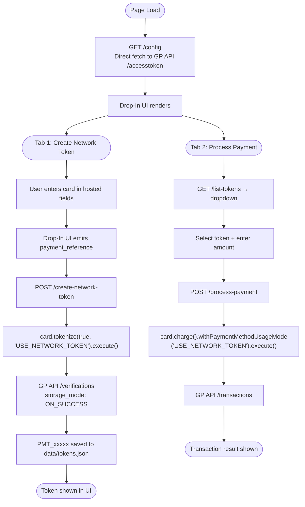

# Network Tokenization — Node.js

Node.js/Express implementation of the network tokenization sample using the Global Payments Node.js SDK.

Part of the [network-tokenization](../) multi-language project.

---

## Requirements

- Node.js 18+
- npm
- GP API credentials (`GP_API_APP_ID`, `GP_API_APP_KEY`) with network tokenization enabled

---

## Project Structure

```
nodejs/
├── .env.sample         # Environment variable template
├── package.json        # Dependencies (globalpayments-api ^3.10.6, express)
├── server.js           # All 4 endpoints in a single Express server
├── data/
│   └── tokens.json     # Saved PMT IDs (auto-created)
├── run.sh              # Install + start server
├── Dockerfile
├── .devcontainer/
└── .codesandbox/
```

---

## Setup

```bash
cp .env.sample .env
# Edit .env — fill in GP_API_APP_ID and GP_API_APP_KEY
./run.sh
```

Open `http://localhost:8000` in your browser.

**Manual start:**

```bash
npm install
node server.js
```

---

## Environment Variables

| Variable | Description | Example |
|----------|-------------|---------|
| `GP_API_APP_ID` | Your GP API application ID | `a8b5f800-...` |
| `GP_API_APP_KEY` | Your GP API application key | `qM31zQFkFh...` |
| `GP_API_ENVIRONMENT` | `sandbox` or `production` | `sandbox` |
| `PORT` | Server listen port (optional) | `8000` |

Credentials available in the [GP Developer Portal](https://developer.globalpayments.com).

---

## SDK Configuration

The `create-network-token` and `process-payment` endpoints configure the SDK before each operation:

```js
const config = new GpApiConfig();
config.appId = process.env.GP_API_APP_ID;
config.appKey = process.env.GP_API_APP_KEY;
config.environment = process.env.GP_API_ENVIRONMENT === 'production' ? 'production' : 'test';
config.channel = Channel.CardNotPresent;
config.country = 'US';

ServicesContainer.configureService(config);
```

The `/config` endpoint uses a direct fetch to the GP API `/accesstoken` endpoint with `permissions: ['PMT_POST_Create_Single']` to scope the Drop-In UI token.

---

## Endpoints

### `GET /config`

Generates a scoped access token for the Drop-In UI. Uses direct HTTP to request a token with only the `PMT_POST_Create_Single` permission.

**Response**
```json
{
  "success": true,
  "data": {
    "accessToken": "S0BiXG7jfVkBPKlMPIR..."
  }
}
```

**Error**
```json
{
  "success": false,
  "message": "Error generating access token",
  "error": "STATUS_CODE: ACTION_NOT_AUTHORIZED"
}
```

---

### `POST /create-network-token`

Converts a single-use Drop-In UI token into a reusable network token using `card.tokenize(true, 'USE_NETWORK_TOKEN')`.

**Request**
```json
{
  "payment_reference": "PMT_single_use_token_from_drop_in"
}
```

```js
const card = new CreditCardData();
card.token = req.body.payment_reference;

const response = await card.tokenize(true, 'USE_NETWORK_TOKEN')
  .withCurrency('USD')
  .execute();
```

**Response**
```json
{
  "success": true,
  "data": {
    "id": "PMT_a1b2c3d4e5f6g7h8",
    "brand": "VISA",
    "masked_card": "2970",
    "usage_mode": "USE_NETWORK_TOKEN",
    "status": "Active",
    "created_at": "2025-05-11T14:30:00.000Z"
  },
  "message": "Network token created successfully"
}
```

**Error**
```json
{
  "success": false,
  "message": "Failed to create network token",
  "error": "no token returned"
}
```

---

### `GET /list-tokens`

Returns all network tokens saved in `data/tokens.json`.

**Response**
```json
{
  "success": true,
  "data": [
    {
      "id": "PMT_a1b2c3d4e5f6g7h8",
      "brand": "VISA",
      "masked_card": "2970",
      "usage_mode": "USE_NETWORK_TOKEN",
      "status": "Active",
      "created_at": "2025-05-11T14:30:00.000Z"
    }
  ]
}
```

---

### `POST /process-payment`

Charges a saved network token using `card.charge().withPaymentMethodUsageMode('USE_NETWORK_TOKEN')`.

**Request**
```json
{
  "pmt_id": "PMT_a1b2c3d4e5f6g7h8",
  "amount": 10.00,
  "currency": "USD"
}
```

```js
const card = new CreditCardData();
card.token = req.body.pmt_id;

const response = await card.charge(amount)
  .withCurrency(currency)
  .withPaymentMethodUsageMode('USE_NETWORK_TOKEN')
  .execute();
```

**Response**
```json
{
  "success": true,
  "data": {
    "transactionId": "TRN_xxxxxxxxxxxx",
    "status": "CAPTURED",
    "amount": 10.00,
    "currency": "USD",
    "authCode": "123456",
    "tokenUsageMode": "USE_NETWORK_TOKEN"
  },
  "message": "Payment processed successfully"
}
```

**Error**
```json
{
  "success": false,
  "message": "Payment processing failed",
  "error": "Transaction declined: Insufficient funds"
}
```

---

## Flow



---

## Test Cards

Network tokenization requires a specific test card:

| Brand | Number | CVV | Expiry |
|-------|--------|-----|--------|
| Visa | 4622 9431 2305 2970 | 999 | 12/25 |

Standard sandbox cards:

| Brand | Number | CVV | Expiry |
|-------|--------|-----|--------|
| Visa | 4263 9826 4026 9299 | 123 | Any future |
| Mastercard | 5425 2334 2424 1200 | 123 | Any future |

---

## Docker

```bash
docker build -t network-tokenization-nodejs .
docker run -p 8000:8000 --env-file .env network-tokenization-nodejs
```

---

## Troubleshooting

**`ACTION_NOT_AUTHORIZED` on startup** — `GP_API_APP_ID` or `GP_API_APP_KEY` is wrong, or network tokenization is not enabled on the account. Verify credentials in the Developer Portal.

**Drop-In UI does not render** — The access token from `/config` has expired (600 s TTL). Reload the page to fetch a fresh token.

**`Failed to create network token`** — Network tokenization may not be enabled on the sandbox account. Contact Global Payments support to confirm `PMT_POST_Create_Single` is available.

**`node: command not found`** — Install Node.js 18+ from [nodejs.org](https://nodejs.org).

**Port already in use** — Set `PORT=8001` in `.env` and restart.
