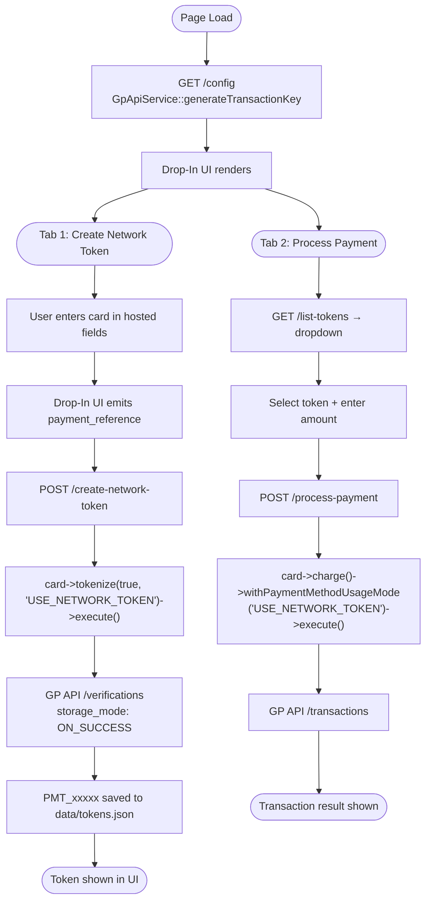

# Network Tokenization — PHP

PHP implementation of the network tokenization sample using the Global Payments PHP SDK.

Part of the [network-tokenization](../) multi-language project.

---

## Requirements

- PHP 8.2+
- Composer
- GP API credentials (`GP_API_APP_ID`, `GP_API_APP_KEY`) with network tokenization enabled

---

## Project Structure

```
php/
├── .env.sample                 # Environment variable template
├── composer.json               # Dependencies (globalpayments/php-sdk ^13.4)
├── config.php                  # GET /config — Drop-In UI access token
├── create-network-token.php    # POST /create-network-token — tokenize card
├── list-tokens.php             # GET /list-tokens — saved token list
├── process-payment.php         # POST /process-payment — charge network token
├── data/
│   └── tokens.json             # Saved PMT IDs (auto-created)
├── run.sh                      # Install + start server
├── Dockerfile
├── .devcontainer/
└── .codesandbox/
```

---

## Setup

```bash
cp .env.sample .env
# Edit .env — fill in GP_API_APP_ID and GP_API_APP_KEY
./run.sh
```

Open `http://localhost:8000` in your browser.

**Manual start:**

```bash
composer install
php -S 0.0.0.0:8000
```

---

## Environment Variables

| Variable | Description | Example |
|----------|-------------|---------|
| `GP_API_APP_ID` | Your GP API application ID | `a8b5f800-...` |
| `GP_API_APP_KEY` | Your GP API application key | `qM31zQFkFh...` |
| `GP_API_ENVIRONMENT` | `sandbox` or `production` | `sandbox` |
| `PORT` | Server listen port (optional) | `8000` |

Credentials available in the [GP Developer Portal](https://developer.globalpayments.com).

---

## SDK Configuration

Each endpoint file configures the GP API SDK with `GpApiConfig`:

```php
$config = new GpApiConfig();
$config->appId = $_ENV['GP_API_APP_ID'];
$config->appKey = $_ENV['GP_API_APP_KEY'];
$config->environment = ($_ENV['GP_API_ENVIRONMENT'] ?? 'sandbox') === 'production'
    ? Environment::PRODUCTION
    : Environment::TEST;
$config->channel = Channel::CardNotPresent;
$config->country = 'US';

ServicesContainer::configureService($config);
```

The `/config` endpoint also sets `$config->permissions = ['PMT_POST_Create_Single']` to scope the Drop-In UI access token.

---

## Endpoints

### `GET /config` — config.php

Generates a scoped access token for the Drop-In UI. The token carries only the `PMT_POST_Create_Single` permission, limiting its use to card tokenization.

```php
$sessionToken = GpApiService::generateTransactionKey($config);
```

**Response**
```json
{
  "success": true,
  "data": {
    "accessToken": "S0BiXG7jfVkBPKlMPIR..."
  }
}
```

**Error**
```json
{
  "success": false,
  "message": "Configuration error: Status Code: ACTION_NOT_AUTHORIZED"
}
```

---

### `POST /create-network-token` — create-network-token.php

Converts a single-use Drop-In UI token into a multi-use network token (`PMT_xxxxx`). Calls the GP API SDK's `tokenize(true, 'USE_NETWORK_TOKEN')` which posts to `/verifications` with `storage_mode: ON_SUCCESS`.

**Request**
```json
{
  "payment_reference": "PMT_single_use_token_from_drop_in"
}
```

```php
$card = new CreditCardData();
$card->token = $input['payment_reference'];

$response = $card->tokenize(true, 'USE_NETWORK_TOKEN')
    ->withCurrency('USD')
    ->execute();

// $response->token = PMT_xxxxx (the reusable network token)
```

**Response**
```json
{
  "success": true,
  "data": {
    "id": "PMT_a1b2c3d4e5f6g7h8",
    "brand": "VISA",
    "masked_card": "2970",
    "usage_mode": "USE_NETWORK_TOKEN",
    "status": "VERIFIED",
    "created_at": "2025-05-11T14:30:00+00:00"
  },
  "message": "Network token created successfully"
}
```

**Error**
```json
{
  "success": false,
  "message": "Gateway error: no token returned"
}
```

---

### `GET /list-tokens` — list-tokens.php

Returns all network tokens saved in `data/tokens.json`.

**Response**
```json
{
  "success": true,
  "data": [
    {
      "id": "PMT_a1b2c3d4e5f6g7h8",
      "brand": "VISA",
      "masked_card": "2970",
      "usage_mode": "USE_NETWORK_TOKEN",
      "status": "VERIFIED",
      "created_at": "2025-05-11T14:30:00+00:00"
    }
  ]
}
```

---

### `POST /process-payment` — process-payment.php

Charges a saved network token. `withPaymentMethodUsageMode('USE_NETWORK_TOKEN')` instructs the card network to return a fresh cryptogram for each transaction.

**Request**
```json
{
  "pmt_id": "PMT_a1b2c3d4e5f6g7h8",
  "amount": 10.00,
  "currency": "USD"
}
```

```php
$card = new CreditCardData();
$card->token = $input['pmt_id'];

$response = $card->charge($amount)
    ->withCurrency($currency)
    ->withPaymentMethodUsageMode('USE_NETWORK_TOKEN')
    ->execute();
```

**Response**
```json
{
  "success": true,
  "data": {
    "transactionId": "TRN_xxxxxxxxxxxx",
    "status": "CAPTURED",
    "amount": 10.00,
    "currency": "USD",
    "authCode": "123456",
    "tokenUsageMode": "USE_NETWORK_TOKEN"
  },
  "message": "Payment processed successfully"
}
```

**Error**
```json
{
  "success": false,
  "message": "Gateway error: Transaction declined: Insufficient funds"
}
```

---

## Flow



---

## Test Cards

Network tokenization requires a specific test card:

| Brand | Number | CVV | Expiry |
|-------|--------|-----|--------|
| Visa | 4622 9431 2305 2970 | 999 | 12/25 |

Standard sandbox cards:

| Brand | Number | CVV | Expiry |
|-------|--------|-----|--------|
| Visa | 4263 9826 4026 9299 | 123 | Any future |
| Mastercard | 5425 2334 2424 1200 | 123 | Any future |

---

## Docker

```bash
docker build -t network-tokenization-php .
docker run -p 8000:8000 --env-file .env network-tokenization-php
```

---

## Troubleshooting

**`ACTION_NOT_AUTHORIZED` on startup** — `GP_API_APP_ID` or `GP_API_APP_KEY` is wrong, or network tokenization is not enabled on the account. Verify credentials in the Developer Portal.

**Drop-In UI does not render** — The access token from `/config` has expired (600 s TTL) or the `PMT_POST_Create_Single` permission is missing. Reload the page to fetch a fresh token.

**`Failed to create network token`** — The `/verifications` call succeeded but no PMT ID was returned. Network tokenization may not be enabled on the sandbox account. Contact Global Payments support.

**`composer: command not found`** — Install Composer from [getcomposer.org](https://getcomposer.org) or run `php -r "copy('https://getcomposer.org/installer', 'composer-setup.php');" && php composer-setup.php`.

**Port already in use** — Set `PORT=8001` in `.env` and restart.
